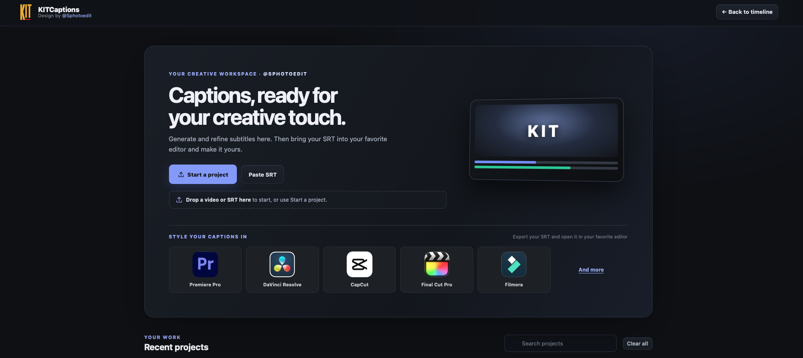
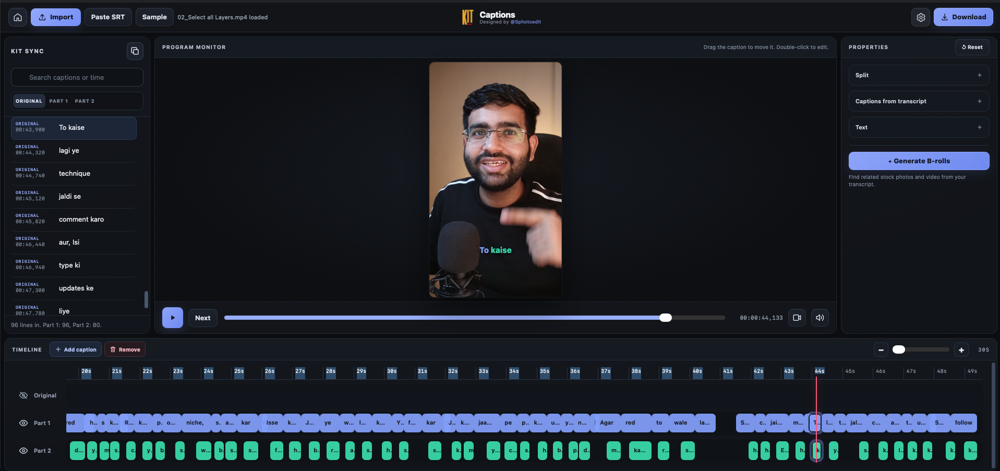
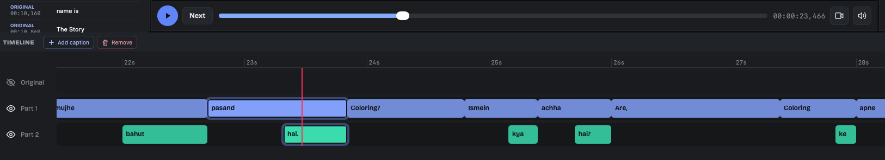
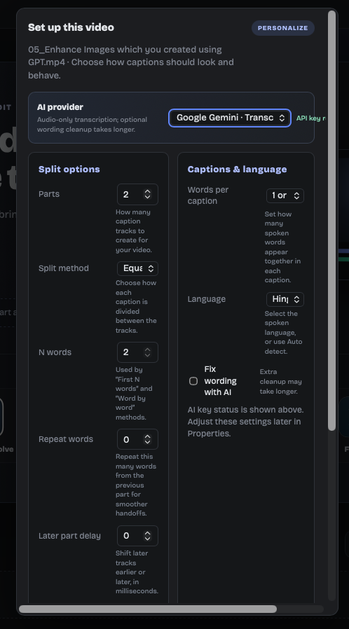
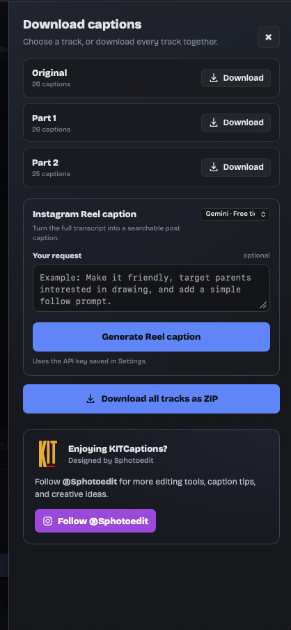

# KITCaptions

KITCaptions is a free, browser-based SRT creation and editing tool for video editors. Generate or refine subtitles, arrange them across multiple timeline tracks, then import the exported SRT into Adobe Premiere Pro or another editor. Choose the caption styling, typography, and animation you want in your editing software.

The timeline can be split into 2ÔøΩ12 caption parts. Transcription uses a supported API provider and your own API key; provider free-tier availability and usage limits may apply.

## Screenshots

### Home screen

### Main caption editor

### Timeline detail

### Caption setup

### Download and SEO caption panel

## Final output preview

https://github.com/user-attachments/assets/ba596fc4-1987-4e96-83b1-4d75509f753d

See the [Instagram video demo](https://www.instagram.com/p/DeW80HEOKMX/) as well.

## What it does

- Import video or audio, or open/paste an existing SRT or WebVTT subtitle file.
- Transcribe audio with Groq Whisper or Google Gemini using your own API key.
- Choose language and caption grouping, including Hinglish-related workflows supported by the selected provider.
- Review the full caption history, edit wording, and split captions across tracks.
- Adjust captions on the timeline and preview them with the video.
- Export individual subtitle tracks or download all tracks together.
- Generate a social caption from the transcript with an AI provider.
- Search Pexels for related B-roll when a Pexels API key is configured.
- Save recent project and preference data in the current browser.

## Use the app

### Open locally

1. Download or clone this repository.
2. Open `KITCaptions.html` in a recent browser, or open `index.html` to be sent to the app.
3. Import media or an SRT/VTT file. You can also paste subtitle text.
4. To transcribe or use AI features, open **Settings**, choose a provider, and enter your own API key.
5. Edit captions in the History panel and timeline, then use **Download** to export SRT files.

Some browser features work best when the page is served over HTTPS or from `localhost` instead of opened as a `file://` URL. GitHub Pages serves the app over HTTPS.

### Host it free with GitHub Pages

1. Create a public GitHub repository and upload the files in this project.
2. In the repository, open **Settings ? Pages**.
3. Under **Build and deployment**, choose **Deploy from a branch**, then select `main` and `/(root)`.
4. Save. GitHub will publish the site at `https://YOUR-USERNAME.github.io/REPOSITORY/` after the Pages build completes.

GitHub Pages is free for public repositories on GitHub Free. See [GitHub Pages documentation](https://docs.github.com/en/pages).

## API keys and privacy

KITCaptions is a static, browser-side app; it does not include a private server. API keys are entered by each user and saved in that browser's local storage. Do not commit API keys or other secrets to the repository. The app sends audio to the selected transcription provider, transcript text to the selected AI provider for optional wording or social-caption generation, and search terms to Pexels when those features are used. Review each provider's current privacy terms, quotas, and pricing before use. Hosting the app on GitHub Pages does not include or pay for provider API usage.

Project and preference data is saved in the current browser. It is not automatically synced between browsers or computers. Keep a backup of important source media and exports.

## Editing and contributing

The app is intentionally easy to edit: its interface, styles, and application logic are contained in [`KITCaptions.html`](KITCaptions.html). You can edit it with any text or code editor, then refresh the browser to see the changes. `index.html` is a small redirect so the GitHub Pages site opens the app at its root address.

To contribute changes:

1. Fork this repository.
2. Edit `KITCaptions.html` and preview it locally.
3. Describe your change clearly and open a pull request.

There is no build step or package installation required for the app itself.

## Project files

- `KITCaptions.html` ÔøΩ complete editable app (HTML, CSS, and JavaScript).
- `index.html` ÔøΩ redirects the site root to the app.
- `assets/screenshots/` ÔøΩ home, main editor, timeline, caption setup, and download screenshots.
- `LICENSE` ÔøΩ MIT License.
- `README.md` ÔøΩ usage, setup, privacy, and contribution notes.

## License

The app source is released under the [MIT License](LICENSE). The MIT license does not grant rights to third-party names, logos, screenshots, media, or services included or referenced by the app. Provider APIs remain subject to their own terms.

---

Designed by [Sphotoedit](https://www.instagram.com/sphotoedit/).
